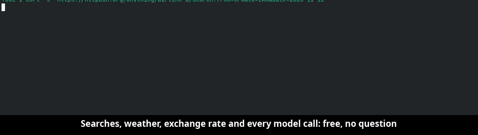

```
  ┌──────────────┐
  │ agent inside │
  │  r   w   x   │── doorman ──▶ world
  └──────────────┘
   read undo ask

  barebox
```

> A lightweight sandbox you spawn per agent, to control what it may do. Reads pass, file writes can be undone, and anything irreversible (pay, send, publish, push) waits for your yes.
> Many sandboxes, one proxy, one gate, one audit file. Up to 40 agents per proxy: for a laptop or a small VPS, not for big swarms.

<p align="center">
  
  
  
</p>



Demo A, a live unedited run: Meta's muse model books a trip. 31 requests, 23 went out with no question, 8 stopped for a person (3 allowed, 5 denied); the real payment key reached the server once, after a yes. Full captioned take: [assets/demo-a.webm](assets/demo-a.webm).

**Replay it** (Linux, from a clone; needs network, httpbin.org stands in for the real services):

```
git clone https://github.com/hamr0/barebox && cd barebox && npm install
bash examples/demo-a/run.sh                       # Demo A scripted: book a trip, all three modes, every cell asserted
bash examples/demo-a/run.sh --driver muse --live --mode auto   # the live run above; needs BASETEN_API_KEY, you answer the holds
bash examples/demo-b/run.sh                       # Demo B: a prompt-injected agent tries 3 exfiltrations in every mode
```

## How it works

```
  agent (your real node, python, git, claude ...)
        |
  +-----+-------- bwrap sandbox (unprivileged, one per agent) --------+
  |  files:   your project, read-only + an undo layer (--overlay)     |
  |  locked:  ~/.ssh, cloud creds, token files -> empty               |
  |  network: none of its own; 127.0.0.1:3128 -> its unix socket      |
  +-----+-------------------------------------------------------------+
        | one unix socket per agent (the socket is the identity, not a header)
        v
   ONE proxy, HTTP and HTTPS  ->  ONE gate (bareguard)  ->  world
        |                              |
        |                              '-> gate.jsonl, one audit line per decision
        '-> held request: asks you in the terminal, forwards or 403
```

- **Walls:** [bubblewrap](https://github.com/containers/bubblewrap), no root, no daemon, no image. The agent uses your installed tools.
- **One proxy for all sandboxes**, plain HTTP and HTTPS. HTTPS is read through a local CA that exists only inside the sandbox, so the gate sees method, URL, headers and body.
- **One gate decides every request** by its letter and the mode (below). It is a simple policy for spawning sandboxed agents on the fly: one flag, no rule files.
- **One audit file**, `<runtime>/gate.jsonl`, one JSON line per decision in [bareguard](https://github.com/hamr0/bareguard)'s shape. It is append-only, so `tail -f` it, pipe it to `jq`, or ship it to your log stack.

## r, w, x and the three modes

Every request gets one letter:

| Letter | What | How barebox gets the letter |
|---|---|---|
| `r` | reads, changes nothing | `GET`, `HEAD`, and calls to model APIs (Anthropic, OpenAI, a `localLlm`) |
| `w` | a change that can be set back | only where an [rwxmap](https://github.com/hamr0/rwxmap) label for that API says so |
| `x` | can't be undone: send, pay, publish, push, delete | every other `POST`, `PUT`, `PATCH`, `DELETE`; any other method is denied |

File writes are a separate layer: with `--overlay` every change lands on an undo layer, and at the end you `sbx diff`, `sbx commit` or `sbx rollback`.

The mode (`sbx run --mode ...`) picks which letters pass without asking:

| Mode | Passes | Asks |
|---|---|---|
| `ask` | `r` | `w`, `x` |
| `auto` (default) | `r`, `w` | `x` |
| `trust` | `r`, `w`, `x` | nothing |

**The floor asks in every mode, `trust` included:** a card number (Luhn) in a body of 64 KB or less, or a payment path (`/checkout`, `/payment`, `/orders`, `/purchase`).

## What it blocks by default

| Blocked | How |
|---|---|
| Keys and credentials: `~/.ssh`, `~/.gnupg`, `~/.password-store`, `~/secrets`, keyrings, browser profiles, `~/.aws`, `~/.azure`, `~/.config/gcloud`, `~/.kube`, `~/.docker`, `~/.config/gh`, `~/.config/op`, `~/.netrc`, `~/.npmrc`, `~/.pypirc`, `~/.git-credentials`, `~/.cargo/credentials.toml` | masked inside the sandbox: they read as empty |
| Your environment | cleared; only a short safe list (`TERM`, `LANG`, `LC_*`, `TZ`, `USER`, `SHELL`, ...) and names you list in `env.pass` get in (names like `*_TOKEN`, `*_KEY` are refused) |
| Any network but the proxy | the sandbox has no network of its own. `--noproxy`, unset proxy env, a direct IP or a raw socket fail closed; UDP and non-HTTP traffic are denied |
| Private and local addresses | the proxy checks every resolved IP (IPv6 spellings of IPv4 included) and refuses private ranges and names that don't resolve |
| Real API keys | the agent holds a per-run placeholder; the proxy swaps in the real key after the gate allows the request, over HTTPS, and only for the key's bound hosts (see below) |
| Answering its own questions | the ask and answer files live outside the sandbox and are masked from it |

## What you see

A held request asks in the terminal where you ran `sbx run` (`y` allows, anything else denies):

```
⏸  auto-agent-1 wants to SEND data to httpbin.org
   Why:  the address looks like a payment
   URL:  POST https://httpbin.org/anything/v1/payment_intents
   Data: {"amount":35000,"currency":"usd"}
   Allow? [y/N] (hold h1)
y
✓ allowed
```

Name the sandbox (`--name docs-bot`) and a second terminal can answer too: `sbx pending --name docs-bot`, `sbx approve h1 --name docs-bot`. A hold waits until you answer; for unattended runs (cron, CI) pass `--hold <seconds>`, and a timeout is a deny. One held request per agent at a time; up to 16 more wait in line.

Demo A's end-of-run summary (from the recorded take):

```
-- what barebox decided:
total                              31 requests to the network: 23 free, 8 held for you (3 allowed, 5 denied) (model calls included)
search                             3 free
pay                                1 held: 1 allowed
POST /anything/hotels/checkout     1 held: 0 allowed, 1 denied
DELETE /anything/bookings/old-123  1 held: 0 allowed, 1 denied
model calls                        18 free (labelled read-only)
key swaps                          1 (the real test key went into the header only after your yes; the agent only ever had the placeholder)
```

An audit line from `gate.jsonl` (a POST held, then denied on timeout):

```json
{"ts":"2026-11-03T21:41:04.869Z","seq":8,"aid":"1a541f36","phase":"gate","action":{"type":"net","tool":"http.POST","url":"https://httpbin.org/post","method":"POST","agent":"rdme","rid":"r2"},"decision":"deny","rule":"rwx.ask","reason":"hold timeout"}
```

## Keys the agent never holds

```json
{
  "secrets": {
    "STRIPE_API_KEY": { "fromEnv": "REAL_STRIPE_KEY", "hosts": ["api.stripe.com"] }
  }
}
```

In `~/.config/barebox/config.json`. Inside, `$STRIPE_API_KEY` is a random placeholder, new each run, and the agent uses it like the key (`curl -H "Authorization: Bearer $STRIPE_API_KEY" ...`). The real value goes into the request header only after the gate allows it, only to `api.stripe.com`, only over HTTPS. Anywhere else the placeholder is refused (`403 denied: secret.host`, `secret.scheme`, `secret.url`).

## Numbers

Measured, not estimated: Fedora, kernel 7.2, bubblewrap 0.12.0, Node 22. Method and raw runs: [findings](docs/logs/findings.md).

| | barebox | [srt](https://github.com/anthropic-experimental/sandbox-runtime) 0.0.81 |
|---|---|---|
| Memory per sandbox | **7.8 MB** mean, 8.0 MB max | ~100 MB (a proxy per sandbox) |
| Shared proxy, normal use (HTTPS, 10-40 agents) | **95-160 MB** | one per sandbox |
| Shared proxy, worst case (HTTPS, every agent with a held request, a full line and a full body slot) | **117 / 133-151 / 177-207 / 207-241 MB** at 10 / 20 / 30 / 40 agents | |
| Total, worst case (proxy + walls) | ~195-200 MB at 10, ~295-310 MB at 20, ~525-560 MB at 40 agents | ~1 GB at 10, ~2 GB at 20 |
| Start to exit, `sbx run -- true` | **0.70 s** median (0.80 s with `--overlay`; bwrap alone 6 ms) | 1.87-2.05 s |
| One real agent (Claude Code) | 248 MB inside vs 249 MB bare; barebox adds ~91 MB for the first agent, ~11 MB per further one | not measured |
| Agents per proxy | **40 max**, enforced (the 41st is refused; run another proxy) | |
| Demo B, 3 exfiltration attempts | **3 of 3 blocked** in every mode | |

Ranges run from a quiet machine to a busy one.

## Known limits

barebox is a guardrail against mistakes and prompt-injected agents, not a security boundary against a determined attacker: the kernel is shared, so use a VM for that. Known gaps, each with a planned fix in [the PRD](docs/product/agent-sandbox-prd.md) (section 10):

- Data in a `GET` URL goes out free: reads are `r`.
- The proxy resolves DNS before the gate decides, so data hidden in a hostname can leak.
- Model API calls pass with any key, an attacker's included.
- Bodies over 64 KB and compressed bodies are not scanned for card numbers.
- `~/.claude` stays readable: Claude Code's tokens refresh themselves.
- Writes over local sockets (a Postgres, a Docker daemon) are not on the undo layer.

## Install

```
npm install barebox
```

Linux. Node.js >= 22.21, `bwrap`, `socat`, `openssl`; bubblewrap >= 0.11.0 for `--overlay` (Ubuntu 24.04 ships 0.9.0). Two dependencies, [bareguard](https://npmjs.com/package/bareguard) and [rwxmap](https://npmjs.com/package/rwxmap), pinned exactly. The `sbx` CLI comes with it; the API is in [`barebox.context.md`](barebox.context.md).

## The bare ecosystem

Local-first, composable agent infrastructure. Same API patterns throughout —
mix and match, each module works standalone.

**Core** — the brain, the gate, the walls, the memory.

- **[bareagent](https://npmjs.com/package/bare-agent)** — the think→act→observe loop. *Goal in → coordinated actions out.* Replaces LangChain, CrewAI, AutoGen.
- **[bareguard](https://npmjs.com/package/bareguard)** — the single gate every action passes through. *Action in → allow / deny / ask-a-human out. Work in → green / red.* Replaces hand-rolled allowlists and scattered policy code.
- **[barebox](https://github.com/hamr0/barebox)** — the walls and the front door, this repo. *Agent in → contained run out: writes undoable, irreversible actions held for a human.* Replaces Docker/VM isolation and approve-everything prompts.
- **[litectx](https://npmjs.com/package/litectx)** — tree-sitter code + memory graph with activation decay, plus lightweight context engineering (write · select · compress · isolate). *Query in → ranked context out.*

**Add-on for bareguard** — labels API operations for the gate.

- **[rwxmap](https://github.com/hamr0/rwxmap)** [WIP] — labels every OpenAPI operation r/w/x as a starting point, marked for review. *API spec in → per-operation letter out.* barebox's doorman uses its labels for known APIs.

**Optional reach** — give the agent hands.

- **[barebrowse](https://npmjs.com/package/barebrowse)** — a real browser for agents. *URL in → pruned snapshot out.* Replaces Playwright, Selenium, Puppeteer.
- **[baremobile](https://npmjs.com/package/baremobile)** — Android + iOS device control. *Screen in → pruned snapshot out.* Replaces Appium, Espresso, XCUITest.
- **[beeperbox](https://github.com/hamr0/beeperbox)** — 50+ messaging networks via one MCP server (headless Beeper Desktop in Docker). *Chat in → unified message stream out.* Replaces Twilio, per-platform bot APIs.

## License

Apache 2.0. See [LICENSE](LICENSE).
